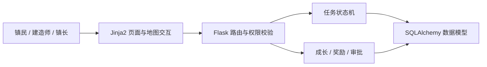

# 春谷镇 · AI 任务协作平台

将团队任务协作设计成“小镇重建”：用户通过领取、执行和验收任务获得成长反馈，让任务状态、角色权限与团队贡献更直观。

**作品集源码快照｜Python · Flask · SQLAlchemy · Jinja2**

> 当前公开副本用于代码与产品思路展示。已从 iCloud 恢复配置、页面和脚本，仍缺少部分图片；运行环境尚未完成复验。详见[完整性说明](MISSING_FILES.md)。本仓库未提供在线演示地址。


*图为历史项目演示材料中的地图素材，用于展示视觉方向，并非本次运行截图。*

## 解决的问题

传统任务列表难以同时表达任务推进、角色分工和贡献激励。本项目将“发布—领取—执行—提交—验收—结算”映射为小镇建设流程，以地图入口组织功能，并用明确的状态转换和权限判断约束操作。

## 可从源码查看的功能

- **任务闭环**：草稿、招募、领取、执行、审核、打回、完成与归档。
- **角色与审批**：拾荒者、建造师、资深建造师、镇长；注册审核与晋升申请。
- **游戏化协作**：重建点、春芽币、每日签到、商店兑换、月度榜单与小镇阶段奖励。
- **通知反馈**：领取、提交、验收、晋升与奖励事件产生站内通知。
- **安全与一致性**：密码哈希、CSRF 校验、登录失败限流、任务状态转换校验及防重复奖励。
- **AI 接口预留/集成**：主程序通过环境变量读取模型配置，本次未验证真实模型调用。

## 下载与浏览

**[下载已恢复源码包](springvale-source.zip)**。压缩包保留原始目录结构；仓库根目录展开核心代码供直接审阅，运行时请先下载并解压源码包。

## 建议阅读顺序

| 文件 | 重点 |
| --- | --- |
| [models.py](models.py) | 任务状态机、数据模型、角色权限、晋升及奖励记录 |
| [app.py](app.py) | 业务流程、登录安全、审批、通知与结算 |
| [test_workflow.py](test_workflow.py) | 既有业务回归用例 |
| `templates/index.html`（源码包内） | 小镇地图主界面 |
| `templates/town_hall.html`（源码包内） | 镇务管理界面 |

## 实现结构



## 项目贡献与边界

本作品展示需求拆解、游戏化流程设计、AI 辅助开发、前后端业务串联、权限与状态机设计、测试和交付整理。第三方框架与素材不作为个人原创底层技术声明。

本次补回 37 个文件；仍有 62 张历史或界面图片未成功从 iCloud 下载。源码说明与测试均保留，运行与视觉完整性仍待验证。请勿把当前快照当作已上线版本。

## 本地运行入口

下载源码并解压后，在源码目录中执行：

```bash
python3 -m venv .venv
source .venv/bin/activate
python -m pip install -r requirements.txt
cp .env.example .env
python app.py
```

浏览器打开 `http://127.0.0.1:5000`。示例配置仅面向本地开发，AI 功能需自行配置模型服务。生产环境需设置随机密钥并关闭演示模式。

既有回归测试：`python -m unittest discover -s tests -v`。

## 本次整理验证

- 已检查现有 Python 源码语法。
- 本次依赖下载遇到本机证书链错误，尚未运行应用与业务测试，也未验证真实 AI 调用。
- 未收录真实环境变量、数据库、账号数据或原始 Git 历史。
- 未添加统一开源授权；代码与素材的使用权应分别以其原有权利归属为准。
